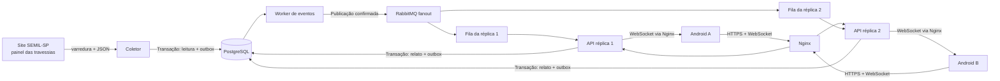

# Arquitetura do ViaAgora

O Nginx é a porta de entrada: recebe os celulares e os reparte entre as duas réplicas da API. Atrás dele rodam seis processos independentes: banco, broker, duas réplicas da API, worker e coletor. Cada um pode cair e voltar sem perder dados, porque o PostgreSQL é a fonte de verdade. O mesmo conjunto roda na VPS e no computador de quem baixa o projeto (`compose.yaml` e `nginx.conf`).

## Coletor (scraper)

O painel do site é desenhado no navegador por um script. O HTML não contém os números. O coletor reproduz o caminho que o navegador faz:

1. Baixa a página `https://semil.sp.gov.br/travessias/` e encontra o `<script>` do painel (`travessia-service-prd.js`).
2. Lê o script e extrai o endereço ativo do serviço (variável `getInfo`), ignorando linhas comentadas.
3. Consulta o serviço, valida cada item com Zod e mantém só as três travessias da Baixada Santista.
4. Normaliza os campos: espera de cada lado, embarcações, tempo, período, aviso sem HTML e horário da consulta convertido de Brasília para UTC. O aviso fixo do 0800 é descartado, porque não descreve a situação atual.

A varredura acontece só na primeira coleta ou quando a leitura falha. Se a página não puder ser lida, o coletor usa o último endereço conhecido. A consulta ocorre a cada 60 segundos, a partir de um único processo. Os celulares nunca acessam o site oficial, o que protege a fonte de excesso de acessos. Em falhas consecutivas, o intervalo dobra até 10 minutos.

Cada leitura é gravada em `crossing_snapshots`, o que forma o histórico. Um evento `crossing.updated` vai para a outbox só quando a espera, as embarcações, o tempo ou o aviso mudam. Uma falha incrementa `collector_state.failures`. A primeira falha e a recuperação geram eventos `source.status`. Leituras com mais de 10 minutos são entregues com `stale: true` e o app as mostra como "dado atrasado".

## Eventos e consistência

A API não depende de uma notificação para salvar dados. A outbox (`outbox_events`) guarda o evento na mesma transação do relato ou da leitura, sem janela entre salvar e enfileirar. O worker usa `FOR UPDATE SKIP LOCKED` e confirmação do broker. Em falha, a transação é revertida e os eventos continuam pendentes. Pode haver reentrega, por isso o cliente sempre busca o estado atual em vez de aplicar o evento diretamente.

Cada réplica usa uma fila exclusiva ligada ao exchange fanout, de modo que **todas** as réplicas recebem cada evento. Uma fila única com consumidores concorrentes dividiria as mensagens entre as réplicas.

## Contratos da API

- `POST /v1/participants`: participação anônima por instalação; retorna o token uma única vez.
- `GET /v1/crossings`: as três travessias, com terminais, última leitura (`status`), mediana da comunidade por lado (`community.A`/`community.B`), relatos ativos e estado da fonte (`source`).
- `GET /v1/crossings/:id/history?days=7`: média por hora do dia, série das últimas 6 horas, melhor hora de cada lado (entre 6h e 22h). Leituras com a travessia parada ficam fora das médias.
- `GET /v1/reports`: relatos recentes; filtros `crossing`, `category`, `status`, `sinceMinutes` (padrão 180) e `limit` (até 500).
- `POST /v1/reports`: Bearer token e `Idempotency-Key` UUID. Campos: `crossingId`, `side` (A/B), `category` (`fila`, `embarque_lento`, `interrompida`, `clima`, `acidente`), `waitMinutes` opcional (0–600), `description` opcional (até 400) e coordenadas.
- `PATCH /v1/reports/:id/resolve`: só o autor encerra; repetir não duplica eventos.
- `GET /health`: estado do banco, do broker e do coletor. Só banco e broker afetam o código HTTP.
- `GET /v1/system`: réplica que atende a consulta, sinais de vida dos processos, pendências da outbox, contadores e rastros de entrega dos eventos.
- WebSocket `/v1/events`: `ready`, `resync`, `broker.status`, `crossing.updated`, `report.created`, `report.resolved` e `source.status`.

A chave de idempotência é única por participante. Reutilizá-la com outro conteúdo devolve 409. O token é aleatório e só seu SHA-256 fica no banco.

## Aplicativo Android

Kotlin nativo, sem framework de UI adicional. As telas são Travessias, Mapa, Relatos e Bastidores. A última desenha os processos do sistema com ícones, mostra os sinais de vida, a réplica a que o celular está ligado e o caminho do último evento, com os tempos medidos. O APK abre conectado à VPS; em Ajustes → Outro servidor é possível ligá-lo ao sistema rodando no próprio computador. Além do canal ao vivo, o app busca os dados de novo a cada 30 segundos, para não perder relatos se o WebSocket cair.

Os sinais de vida são gravados a cada cinco segundos. O registro da publicação usa o relógio do PostgreSQL antes do envio, e a pendência é encerrada somente após confirmação do broker. Os tempos representam os intervalos registrados entre criação, publicação e entrega às réplicas; o último trecho até a renderização no celular não tem confirmação individual instrumentada.

## Limites

O serviço oficial não é uma API aberta documentada e pode mudar ou bloquear consultas. Nesse caso o coletor registra a falha e o app continua mostrando o último dado, marcado como atrasado. Não há moderação de relatos nem recuperação da participação após desinstalar. A VPS é um único servidor físico: as réplicas protegem contra a queda de um processo, não da máquina.

## Referências das tecnologias

- [Android e Kotlin](https://developer.android.com/kotlin)
- [MapLibre Native para Android](https://maplibre.org/maplibre-native/android/examples/)
- [OpenStreetMap — direitos e atribuição](https://www.openstreetmap.org/copyright)
- [Fastify](https://fastify.dev/docs/latest/)
- [PostgreSQL — transações](https://www.postgresql.org/docs/16/tutorial-transactions.html)
- [RabbitMQ — publish/subscribe](https://www.rabbitmq.com/tutorials/tutorial-three-javascript)
- [RabbitMQ — confirmações](https://www.rabbitmq.com/docs/confirms)
- [Travessias Litorâneas — SEMIL-SP](https://semil.sp.gov.br/travessias/)

